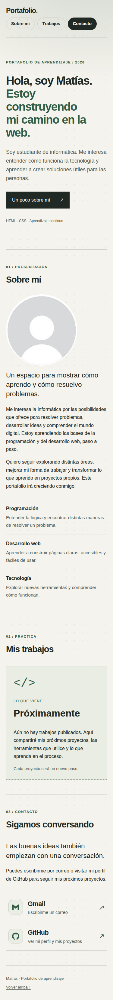
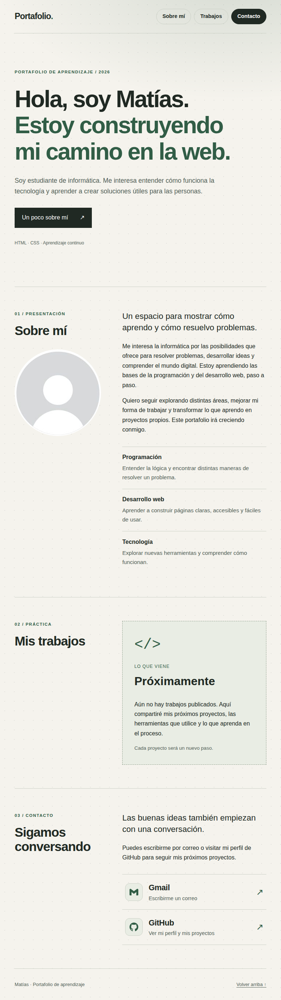
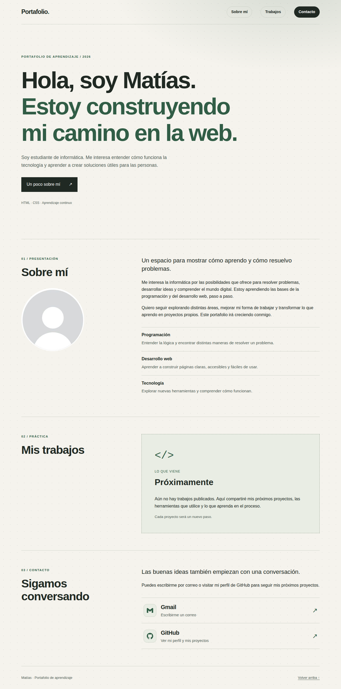

# Portafolio · Matías

## Descripción
Portafolio personal de Matías, hecho solo con **HTML y CSS** (sin JavaScript ni librerías). Incluye presentación, intereses, un aviso de trabajos «Próximamente» y contacto.

## Cómo abrirlo
Abrir `index.html` en el navegador. No requiere instalar nada.

Versión publicada: https://mmanquelaf.github.io/portafolio/

## Tecnologías
- HTML5 semántico
- CSS3 externo (variables, Flexbox, Grid, media queries y `prefers-color-scheme`)
- Sin JavaScript ni librerías

## Estructura de carpetas
```
portafolio/
├── index.html               estructura y contenido
├── README.md
└── assets/
    ├── css/
    │   └── styles.css       estilos externos (clases BEM y 3 puntos de quiebre)
    └── img/
        ├── favicon.svg
        ├── perfil.jpg       foto de perfil
        └── capturas/        movil.png, tablet.png, escritorio.png
```
Cada tipo de archivo vive en su carpeta (HTML en la raíz y, dentro de `assets/`, los estilos en `css/` y las imágenes en `img/`), de modo que agregar páginas, estilos o imágenes no obliga a reordenar nada.

## Capturas
| Móvil (375 px) | Tablet (768 px) | Escritorio (1280 px) |
|---|---|---|
|  |  |  |

## Decisiones de diseño
**Audiencia:** personas que quieran conocer cómo aprendo (reclutadores, equipos de práctica, otros estudiantes).

- **Orden:** presentación → sobre mí → trabajos → contacto. Primero quién soy; después la evidencia; al final cómo escribirme.
- **Jerarquía visual:** un `h1` muy grande como foco, `h2` medianos para cada sección y `h3` pequeños para los detalles. El verde acento resalta lo importante (la segunda línea del título, las etiquetas) y el botón oscuro es la acción principal.
- **Estilo:** colores sobrios, mucho espacio entre secciones y navegación directa. Los enlaces de la cabecera son botones redondeados y «Contacto» va relleno para destacar.
- **Modo claro y oscuro:** el sitio se adapta solo al tema del dispositivo con `prefers-color-scheme`. Los colores son variables CSS, así que el modo oscuro solo cambia sus valores.
- **Fondo:** un resplandor verde muy suave arriba a la derecha y una trama de puntitos casi invisible, hechos solo con `radial-gradient`. Dan algo de vida sin quitar contraste al texto.
- **Contacto:** dos filas clicables, «Gmail» (abre la redacción del correo) y «GitHub» (abre mi perfil), cada una con su ícono en SVG dentro del HTML (sin imágenes externas). Los íconos son decorativos (`aria-hidden`) porque el texto del enlace ya dice a dónde lleva.
- **Trabajos:** por ahora la sección muestra «Próximamente», sin enlace ni botón, porque aún no hay proyectos publicados.

### Puntos de quiebre (mobile-first)
| Ancho | Cambios |
|---|---|
| Base (móvil) | 1 columna, títulos más pequeños |
| 480 px | cabecera y pie pasan a una sola fila |
| 768 px (tablet) | secciones en 2 columnas, títulos más grandes |
| 1100 px (escritorio) | más espacio vertical, título principal más grande |

## Accesibilidad declarada (WCAG / WAI-ARIA)
- **Estructura semántica:** `header`, `nav`, `main`, `section` y `footer`. Son landmarks nativos, por eso no se repiten con roles ARIA.
- **Idioma:** `lang="es"` en `<html>`.
- **Encabezados:** un solo `h1`, secciones con `h2` e intereses con `h3`, sin saltar niveles.
- **`aria-labelledby`:** cada sección toma el nombre de su título visible.
- **`aria-label`:** nombra la navegación, el logo y los enlaces de Gmail y GitHub.
- **`aria-hidden="true"`:** oculta solo símbolos decorativos (flechas, íconos de Gmail y GitHub, `</>` y el punto del logo).
- **Teclado:** todos los enlaces son nativos, tienen foco visible (`:focus`) y hay un enlace «Saltar al contenido».
- **Imagen:** la foto de perfil usa `` con `alt` descriptivo; hoy es un avatar genérico y su `alt` lo dice.
- **Modo oscuro:** ambos temas mantienen buen contraste entre texto y fondo.
- **Formularios:** no hay, por eso no se agregan `label`.
- **Auditoría automática:** axe-core sin violaciones (reglas WCAG 2.0, 2.1 y 2.2 niveles A y AA) en modo claro y oscuro, y sin desplazamiento horizontal entre 320 y 1280 px.
- Falta revisar con Lighthouse y con un lector de pantalla, así que no se declara cumplimiento total de WCAG.

## Trabajo con Git
- Repositorio personal en GitHub: https://github.com/mmanquelaf/portafolio
- Commits pequeños con mensajes convencionales: `feat:`, `fix:`, `docs:` y `style:`.

## Pendientes
- Foto: reemplazar `assets/img/perfil.jpg` por mi foto real y cambiar el `alt` a «Retrato de Matías».
- Probar con teclado, zoom y distintos tamaños de pantalla.
- Reemplazar «Próximamente» por proyectos reales cuando existan.

## Declaración de uso de IA
Usé Claude (Anthropic) como ayuda para ordenar y revisar el código y la documentación. Revisé el resultado y soy responsable del contenido publicado.
