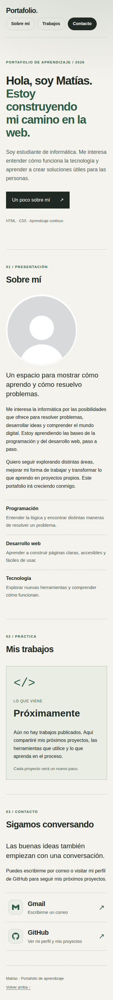
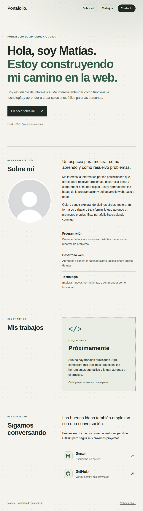
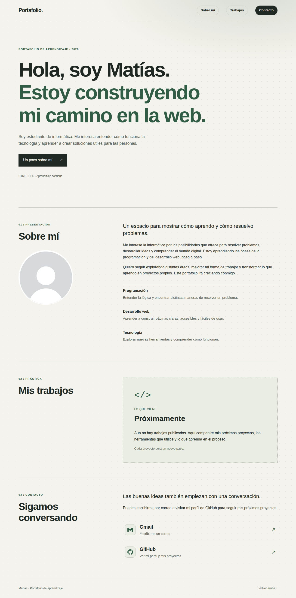

# Portafolio · Matías

## Descripción
Portafolio personal de Matías, hecho con **HTML, CSS y JavaScript**, sin frameworks. Incluye presentación, intereses, una tarjeta de SpaceShooter y un formulario de contacto conectado a Formspree. Esta actualización mantiene el estilo del portafolio original de la EV2; la migración a React + TypeScript para la EV4 corresponde a otro repositorio.

## Cómo abrirlo
Abrir `index.html` en el navegador. No requiere instalar nada.

Versión publicada: https://mmanquelaf.github.io/portafolio/

## Tecnologías
- HTML5 semántico
- CSS3 externo (variables, Flexbox, Grid, media queries y `prefers-color-scheme`)
- JavaScript nativo: validaciones y envío asíncrono del formulario
- Formspree como servicio externo de recepción de mensajes

## Estructura de carpetas
```
portafolio/
├── index.html               estructura y contenido
├── README.md
└── assets/
    ├── css/
    │   └── styles.css       estilos externos (clases BEM y 3 puntos de quiebre)
    ├── js/
    │   └── contacto.js     validaciones y envío del formulario
    └── img/
        ├── favicon.svg
        ├── perfil.jpg       foto de perfil
        └── capturas/        movil.png, tablet.png, escritorio.png
```
Cada tipo de archivo vive en su carpeta (HTML en la raíz y, dentro de `assets/`, los estilos en `css/` y las imágenes en `img/`), de modo que agregar páginas, estilos o imágenes no obliga a reordenar nada.

## Capturas
Estas capturas corresponden a la versión original de la EV2, anterior al formulario y a la tarjeta de SpaceShooter.

| Móvil (375 px) | Tablet (768 px) | Escritorio (1280 px) |
|---|---|---|
|  |  |  |

## Decisiones de diseño
**Audiencia:** personas que quieran conocer cómo aprendo (reclutadores, equipos de práctica, otros estudiantes).

- **Orden:** presentación → sobre mí → trabajos → contacto. Primero quién soy; después la evidencia; al final cómo escribirme.
- **Jerarquía visual:** un `h1` muy grande como foco, `h2` medianos para cada sección y `h3` pequeños para los detalles. El verde acento resalta lo importante (la segunda línea del título, las etiquetas) y el botón oscuro es la acción principal.
- **Estilo:** colores sobrios, mucho espacio entre secciones y navegación directa. Los enlaces de la cabecera son botones redondeados y «Contacto» va relleno para destacar.
- **Modo claro y oscuro:** el sitio se adapta solo al tema del dispositivo con `prefers-color-scheme`. Los colores son variables CSS, así que el modo oscuro solo cambia sus valores.
- **Fondo:** un resplandor verde muy suave arriba a la derecha y una trama de puntitos casi invisible, hechos solo con `radial-gradient`. Dan algo de vida sin quitar contraste al texto.
- **Contacto:** dos filas clicables, «Gmail» (abre la redacción del correo) y «GitHub» (abre mi perfil), cada una con su ícono en SVG dentro del HTML (sin imágenes externas). Los íconos son decorativos (`aria-hidden`) porque el texto del enlace ya dice a dónde lleva.
- **Trabajos:** una tarjeta de SpaceShooter enlaza directamente al repositorio, sin modal. Se eleva suavemente con ratón o foco de teclado. La animación se desactiva con `prefers-reduced-motion`. Se identifica como trabajo académico en equipo.
- **Formulario:** tarjeta redondeada con los colores existentes. Nombre y correo comparten fila en escritorio (desde 1100 px); en anchos menores se apilan para conservar espacio legible dentro de la columna de contacto. Asunto y mensaje ocupan todo el ancho. Se mantienen los enlaces alternativos de contacto.

### Puntos de quiebre (mobile-first)
| Ancho | Cambios |
|---|---|
| Base (móvil) | 1 columna, títulos más pequeños |
| 480 px | cabecera y pie pasan a una sola fila |
| 768 px (tablet) | secciones en 2 columnas, títulos más grandes |
| 1100 px (escritorio) | más espacio vertical, título principal más grande |

## Accesibilidad declarada (WCAG / WAI-ARIA)
- **Estructura semántica:** `header`, `nav`, `main`, `section` y `footer`. Son landmarks nativos, por eso no se repiten con roles ARIA.
- **Idioma:** `lang="es"` en `<html>`.
- **Encabezados:** un solo `h1`, secciones con `h2` e intereses con `h3`, sin saltar niveles.
- **`aria-labelledby`:** cada sección toma el nombre de su título visible.
- **`aria-label`:** nombra la navegación, el logo y los enlaces de Gmail y GitHub.
- **`aria-hidden="true"`:** oculta solo símbolos decorativos (flechas, íconos de Gmail y GitHub, `</>` y el punto del logo).
- **Teclado:** todos los enlaces son nativos, tienen foco visible (`:focus`) y hay un enlace «Saltar al contenido».
- **Imagen:** la foto de perfil usa `` con `alt` descriptivo; hoy es un avatar genérico y su `alt` lo dice.
- **Modo oscuro:** ambos temas mantienen buen contraste entre texto y fondo.
- **Formularios:** cada campo tiene `label`; se usan `autocomplete`, campos obligatorios, límites de longitud, errores relacionados con `aria-describedby`, `aria-invalid` y una región de estado anunciada con `aria-live`. El foco se dirige al primer campo inválido.
- **Auditoría anterior:** el README original declaraba resultados de axe-core para la EV2. Esa auditoría no se ha repetido después de esta actualización; no se presenta como validación del nuevo formulario.
- Falta revisar con Lighthouse y con un lector de pantalla, así que no se declara cumplimiento total de WCAG.

## Trabajo con Git
- Repositorio personal en GitHub: https://github.com/mmanquelaf/portafolio
- Commits pequeños con mensajes convencionales: `feat:`, `docs:`.

## Pendientes
- Foto: reemplazar `assets/img/perfil.jpg` por mi foto real y cambiar el `alt` a «Retrato de Matías».
- Probar con teclado, zoom y distintos tamaños de pantalla.
- Comprobar un envío real desde el dominio publicado y confirmar la recepción en el correo configurado en Formspree.
- Renovar las capturas tras publicar la actualización.

## Declaración de uso de IA
Usé Claude (Anthropic) como ayuda para ordenar y revisar el código y la documentación. Revisé el resultado y soy responsable del contenido publicado.

## Formulario de contacto

El formulario usa `POST https://formspree.io/f/maeoopdj` y envía `name`, `email`, `subject` y `message`. El campo `email` permite identificar el correo del remitente. No hay contraseñas ni claves privadas en el código. Los mensajes se procesan mediante Formspree; se informa al visitante junto al botón.

- Nombre: al menos 2 caracteres sin contar espacios al principio o al final; máximo 100.
- Correo: formato de correo válido y máximo 254 caracteres.
- Asunto: opcional, máximo 150 caracteres.
- Mensaje: al menos 10 caracteres sin contar espacios al principio o al final; máximo 5000.
- Durante el envío se bloquea el botón para evitar duplicados y se impide editar los campos.
- Solo se vacía el formulario cuando el servicio devuelve una respuesta HTTP exitosa.
- Ante errores HTTP o de conexión se conserva el contenido y se permite reintentar. Un timeout indica que no se pudo confirmar el resultado; no se reenvía automáticamente.
- Si JavaScript está desactivado, se conserva el envío HTML nativo y la validación del navegador; Formspree presenta su propia respuesta.
- Si el panel de Formspree restringe dominios, se debe autorizar `mmanquelaf.github.io`. Confirmar que el formulario esté activo y el correo receptor verificado en ese panel.

## Verificación de la actualización

Con Node.js instalado, ejecutar `node --test tests/contacto.test.cjs`. Las seis pruebas usan respuestas simuladas: no generan mensajes ni consumen envíos. Cubren validación, éxito, errores HTTP y de red, bloqueo de duplicados, límite del servicio y timeout.

Se revisaron visualmente la vista de escritorio y los errores de campos vacíos en el navegador. No se realizó un envío real ni se verificó la recepción por correo. Quedan pendientes la comprobación visual de móvil/tablet, modo oscuro y una nueva auditoría de accesibilidad.

La actualización del formulario, su JavaScript, las pruebas y la tarjeta de SpaceShooter se preparó con asistencia de ChatGPT. La declaración anterior sobre Claude corresponde a la versión original.

## Organización e interacciones
- `index.html`: contenido y estructura de la página.
- `assets/css/styles.css`: estilos base, componentes y formulario.
- `assets/css/layout.css`: distribución responsive y temas explícitos.
- `assets/js/contacto.js`: validación y envío a Formspree.
- `assets/js/interfaz.js`: tema guardado, menú móvil, sección activa y contador del mensaje.
- `assets/img/`: imágenes y capturas.
- `tests/`: pruebas aisladas del formulario; no forman parte de la interfaz.

El menú funciona con teclado y se cierra con Escape. El tema sigue al dispositivo hasta elegir uno manualmente. Los efectos respetan la preferencia de movimiento reducido. Sin JavaScript, los enlaces y el envío HTML del formulario siguen disponibles.
