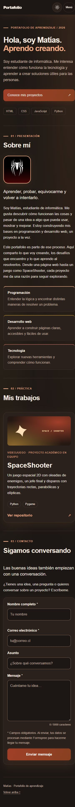
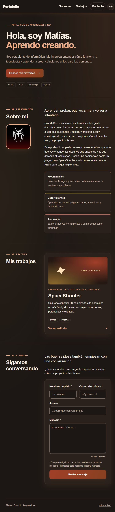
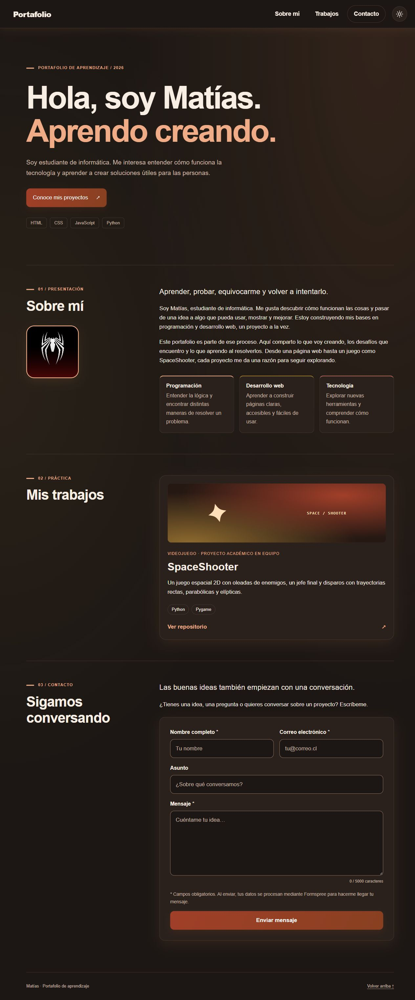
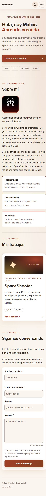

# Portafolio · Matías

Portafolio personal de aprendizaje construido con HTML, CSS y JavaScript nativo, sin frameworks. Incluye presentación, intereses, el proyecto académico en equipo SpaceShooter y un formulario de contacto con Formspree.

## Abrir el proyecto

Abre `index.html` en el navegador. No requiere instalar dependencias para visitar el sitio.

- Sitio: https://mmanquelaf.github.io/portafolio/
- Repositorio: https://github.com/mmanquelaf/portafolio

Los cambios locales se reflejan en el sitio publicado después de subirlos y completarse la publicación de GitHub Pages.

## Estructura

```text
portafolio/
├── index.html
├── README.md
├── assets/
│   ├── css/
│   │   ├── styles.css       estilos base y formulario
│   │   └── layout.css       distribución, paleta y ajustes responsive
│   ├── js/
│   │   ├── contacto.js     validación y envío del formulario
│   │   └── interfaz.js     tema, menú, navegación y progreso
│   └── img/
│       ├── favicon.svg
│       ├── perfil.jpg      imagen de Spider-Man elegida como avatar
│       └── capturas/       capturas actuales de GitHub Pages
└── tests/
    └── contacto.test.cjs   pruebas aisladas del formulario
```

## Diseño

- Paleta clara de crema y terracota; tema oscuro de café profundo y acentos durazno.
- Cabecera fija al desplazarse, de ancho completo, con la marca «Portafolio».
- La sección activa se destaca con un relleno que sigue la paleta del tema.
- Barra de progreso de lectura bajo la navegación.
- Tarjetas de intereses y de SpaceShooter con espacios y tamaños adaptados a pantallas pequeñas.
- Avatar de Spider-Man con encuadre cuadrado y bordes redondeados. Es una imagen decorativa de perfil, no una fotografía personal.
- La sección de contacto contiene el formulario, sin enlaces adicionales de Gmail o GitHub.

## Interacciones con JavaScript

- Selector de tema con iconos de sol y luna. La elección se guarda en `localStorage` cuando está disponible; inicialmente se utiliza el tema del dispositivo.
- Menú móvil hasta 700 px, con estado `aria-expanded`, cierre al seleccionar un enlace y cierre con Escape.
- Seguimiento de la sección activa y del avance de lectura al desplazarse.
- Contador de caracteres del mensaje, actualizado también al reiniciar el formulario.
- Validaciones y envío asíncrono a Formspree.

El formulario conserva el envío HTML nativo cuando JavaScript no está disponible. Las animaciones y el desplazamiento suave respetan la preferencia de movimiento reducido.

## Formulario de contacto

Usa `POST https://formspree.io/f/maeoopdj` y envía `name`, `email`, `subject` y `message`.

- Nombre obligatorio: entre 2 y 100 caracteres; la validación JavaScript descarta espacios exteriores.
- Correo obligatorio: formato válido y máximo 254 caracteres.
- Asunto: máximo 150 caracteres. Puede dejarse vacío, aunque su etiqueta visible muestra solamente «Asunto».
- Mensaje obligatorio: entre 10 y 5000 caracteres; la validación JavaScript descarta espacios exteriores.
- Se bloquean los envíos duplicados y la edición mientras se espera la respuesta.
- El contenido se limpia solo después de una respuesta exitosa. Ante errores se conserva para reintentar.
- Si se agota el tiempo de espera, se informa que el resultado no pudo confirmarse, sin reenviar automáticamente.

No se incluyen contraseñas ni claves privadas. El visitante recibe un aviso sobre el procesamiento mediante Formspree. El propietario confirmó el funcionamiento del formulario el 17 de noviembre de 2026.

## Accesibilidad y adaptación

HTML semántico, idioma español, encabezados jerárquicos, enlace para saltar al contenido y foco visible. Los campos tienen etiquetas y errores asociados; los resultados del envío se anuncian con `aria-live`. El avatar tiene un texto alternativo que describe la imagen y los iconos de tema cuentan con nombres accesibles.

En móvil, las secciones y los campos del formulario se apilan. Desde 768 px, las secciones y la fila de nombre/correo usan dos columnas. Las tarjetas de intereses conservan una columna en anchos intermedios para facilitar la lectura.

Se verificó el contraste de las combinaciones principales de texto, fondos y botones de la paleta actual. Esto no constituye una auditoría completa de accesibilidad.

## Verificación

Con Node.js instalado:

```bash
node --check assets/js/interfaz.js
node --check assets/js/contacto.js
node --test tests/contacto.test.cjs
```

Las seis pruebas del formulario pasaron. Usan respuestas simuladas y no envían correos. Cubren campos inválidos, éxito, errores HTTP y de red, bloqueo de duplicados, límite del servicio y tiempo de espera.

También se comprobaron los archivos referenciados, identificadores y enlaces internos. El 17 de noviembre de 2026 se revisó la versión publicada en GitHub Pages a 375, 768 y 1280 px, sin desbordamiento horizontal en esos tamaños. Se comprobó el menú móvil, su cierre al seleccionar Contacto y la vista del formulario; también se verificó el cambio al tema claro en móvil. Esta revisión usa tamaños simulados de navegador, no dispositivos físicos.

## Pendientes

- Ampliar la revisión en dispositivos físicos, teclado, zoom y tema claro en tablet/escritorio.
- Renovar las capturas cuando cambie el diseño.
- Ejecutar una nueva auditoría de accesibilidad y revisar con lector de pantalla.

## Uso de IA

La versión original se preparó con asistencia de Claude. Las actualizaciones de diseño, texto, formulario, JavaScript y documentación se realizaron con asistencia de ChatGPT/Codex. El propietario revisa el contenido antes de publicarlo.

## Capturas actuales

Capturas de página completa de la versión publicada, tomadas el 17 de noviembre de 2026.

| Móvil · 375 px | Tablet · 768 px | Escritorio · 1280 px |
|---|---|---|
|  |  |  |

<details>
<summary>Móvil en tema claro</summary>



</details>
